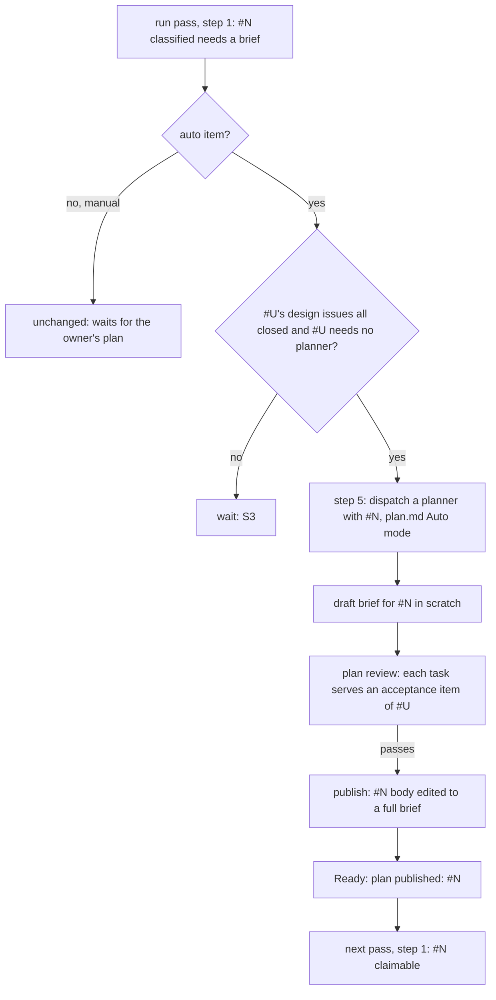
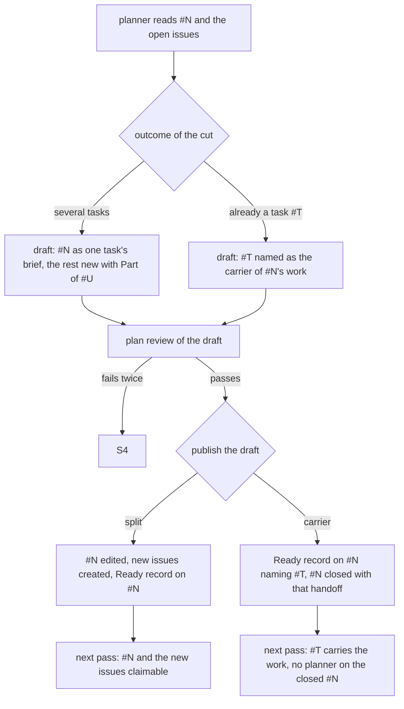
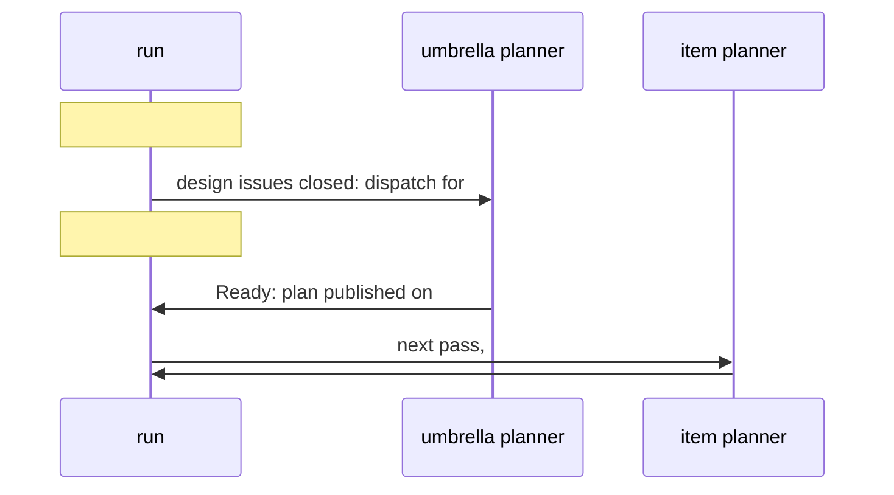
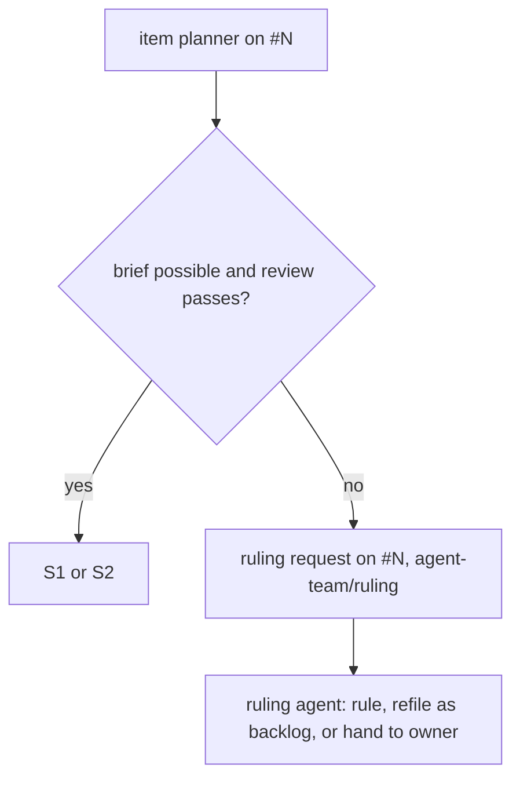
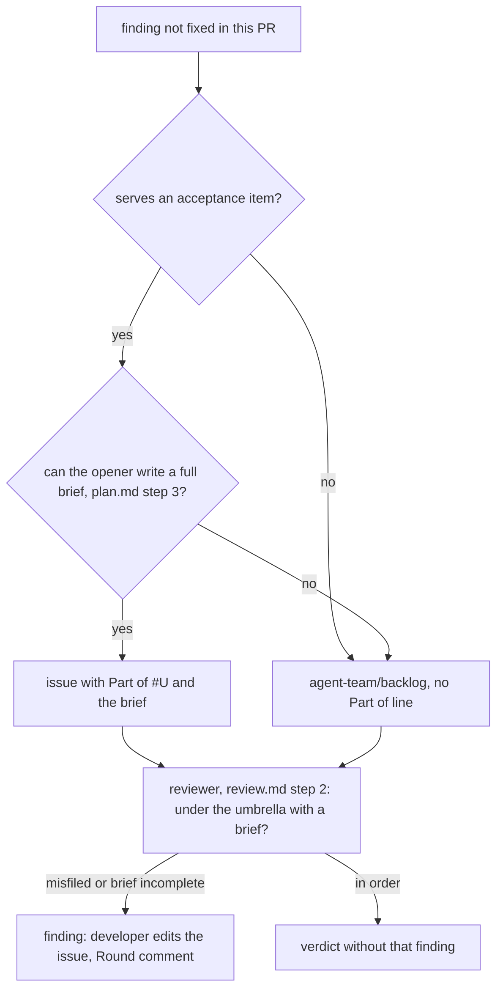

# Design: auto items without a complete brief advance without the owner

Requirement: [#278](https://github.com/jgong5/skills/issues/278), from
[#277](https://github.com/jgong5/skills/issues/277).

Today an issue opened under an auto umbrella without a complete brief is
classified as needs a brief by `run` (`skills/agent-team/SKILL.md`: One
pass, step 1) and nothing dispatches a planner for it: step 5 plans only
the whole umbrella. This design adds a per-item planner (recover) and a
brief duty on whoever opens such an issue (prevent).

## Scenarios

### S1. Recover: an auto item without a brief gets one (A1, A2)

An agent opened #N with `Part of #U` and no file set. The umbrella's own
plan is published. #N ends briefed and claimable.



### S2. Recover: #N splits, or its work is already a task

The planner cuts #N into several tasks, or finds a published task that
already carries its work. Either draft passes the plan review before
anything is published. The tasks end claimable and #N does not stay open
unbriefed.



### S3. Recover waits for the umbrella planner

#U's design issues are still open, or just closed with no plan record in
#U's thread since, so step 5 dispatches the umbrella planner once they
close. #N is unbriefed in the same pool.



### S4. Recover fails: held under agent-team/ruling

The planner cannot brief #N (its work is unclear, or serves no acceptance
item), or a blocking plan-review finding survives the second review.



### S5. Prevent: a developer opens an issue under the umbrella (A3, A4)

A developer on an auto item finds a defect it does not fix in its PR.



### S6. Prevent: the ruling agent re-checks

A ruling request on an auto item concerns an issue another agent opened.
`ruling.md` step 1 reads `rules.md`, whose The task record now names the
brief among what the ruling agent re-checks; issues the ruling agent opens
already carry a brief through `verdict.md` step 4 item 3.

```
ruling request -> ruling agent reads rules.md (The task record)
  -> re-checks the opener's filing and its brief
  -> Ruling (auto): brief it, refile as backlog, or keep
```

### S7. Release (A5)

```
docs edited -> marketplace.json agent-team 0.21.0
  -> gate_task exit 0 -> claude plugin validate . (host) passes
```

## Decisions

1. **One planner per item, through the split's input.** `run` step 5
   dispatches a planner for each in-scope auto item classified needs a
   brief, with that issue as `#N` input to `plan.md` Auto mode: draft,
   plan review, publish. Basis: code: `skills/agent-team/SKILL.md`:
   Dispatching ("One background agent per role per item") and One pass
   step 5 ("each when no agent of yours runs on its item");
   `skills/agent-team/plan.md`: Auto mode already plans one `#N` for a
   split; principle: Reuse existing code and dependencies first. Rejected:
   one planner per umbrella covering all such items, keyed on #U: one
   item's failed plan review holds #U, and with it #U's planner and its
   acceptor.
2. **The item planner waits until its umbrella's `agent-team/design`
   issues are all closed and the umbrella needs no planner** (S3), reusing
   the umbrella planner bullet's design condition and the acceptor
   bullet's "needs no planner". The design condition is needed on its own:
   while a design issue is open the umbrella needs no planner, so "needs
   no planner" alone would brief #N before the design lands. Basis: code:
   `skills/agent-team/plan.md`: Auto mode step 1 takes the design
   documents #U's design issues landed as a planner's input, so a brief
   drafted earlier has no design to cut from; `plan.md` step 1 has a
   planner read the open pool to extend the DAG, so the umbrella planner
   can cut #N's work into a new task while the item planner briefs #N;
   `skills/agent-team/SKILL.md`: One pass step 5, umbrella planner and
   acceptor bullets; principle: Follow the project's existing conventions.
   Rejected: "needs no planner" alone, which briefs #N against no design
   and can file one change twice.
3. **For `#N` input the plan review checks that each task serves an
   acceptance item of #U**; the every-item coverage check stays for #U
   input. Basis: code: `skills/agent-team/plan.md`: Auto mode step 3,
   whose every-item check a one-issue plan always fails;
   `skills/agent-team/rules.md`: The task record, which admits an issue
   under the umbrella only when it serves an acceptance item. Rejected:
   one check for both inputs, which would send every item to
   `agent-team/ruling`. It changes the split path too, which takes the
   same input.
4. **#N ends briefed or closed, and both go through the plan review**
   (S2). A split drafts #N as one task's brief and the rest as new
   issues; a carrier draft names the published task #T that already
   carries #N's work. Either draft passes the plan review, which stands in
   for the owner, before it is published; publishing a carrier draft posts
   the Ready record on #N naming #T and closes #N with that handoff. The
   close meets goal 1's "split into briefed issues": #N's work ends in
   #T, already briefed, the zero-new-issue case of a split. Basis: code:
   `skills/agent-team/plan.md`: Auto mode step 3, the review every draft
   passes, and step 4, publishing only the reviewed draft;
   `skills/agent-team/SKILL.md`: One pass step 1, which classifies an
   open issue without a file set as needs a brief again;
   `skills/agent-team/rules.md`: The task record, on closing with a
   handoff. Rejected: #N kept as a grouping issue (`plan.md` step 2), on
   which decision 1 would dispatch a planner every pass; and closing #N
   without the review, which skips the owner's stand-in.
5. **An issue the planner cannot brief gets a ruling request** with
   `agent-team/ruling` (S4). Basis: requirement goal 1 names two ends,
   claimable or held under `agent-team/ruling`; code:
   `skills/agent-team/rules.md`: The task record gives the re-check of a
   filing to the reviewer or the ruling agent. Rejected: the planner
   relabels it `agent-team/backlog` itself, an end goal 1 does not name.
6. **The opener's duty is one rule in `rules.md`** (S5): the auto-item
   bullet of The task record requires a brief (`plan.md` step 3) on an
   issue under the umbrella, else `agent-team/backlog`, and its re-checkers
   check both. Basis: code: `skills/agent-team/rules.md` binds every role;
   `design.md` step 3, `accept.md` step 4 and `verdict.md` step 4 item 3
   already brief what they open; principle: The simplest solution that
   meets acceptance. Rejected: a sentence per role doc, restating rules.md.
7. **`ruling.md` is unchanged; `review.md` step 2's auto-item bullet adds
   the brief** (S5, S6). Basis: code: `skills/agent-team/rules.md`: The
   task record names the ruling agent as a re-checker, and `ruling.md`
   step 1 reads it. Rejected: a `ruling.md` bullet restating the re-check.
8. **`SKILL.md` One pass step 1 and Dispatching follow decision 1**: step
   1's "it ends in owner review" holds for manual items only, and a
   planner is handed the umbrella or the issue. Basis: code:
   `skills/agent-team/SKILL.md`: One pass step 1 and Dispatching, which
   describe only the umbrella planner. Rejected: leaving them, which tells
   the orchestrator an auto item waits for the owner.
9. **Prose only: no script or test changes.** Basis: code:
   `skills/agent-team/SKILL.md`: One pass step 1 classifies in prose, and
   no script under `skills/agent-team/` classifies issues; `CLAUDE.md`
   (agent-team) tests behaviour only; principle: No generality for
   speculative needs. Rejected: a classifier script, a new moving part.
10. **README is unchanged.** Basis: code: `README.md`: Auto mode describes
    no planner, and says auto mode asks the owner only what to build,
    which this change makes true. Rejected: a sentence restating
    `SKILL.md`.
11. **Version 0.21.0.** Basis: code: `.claude-plugin/marketplace.json`
    history, where 01aa84a and 43bd182 took minor bumps for a step or
    exemption a role did not have, and 51a327a and cfe63e8 took patch
    bumps for corrections to how an existing step behaves. A new dispatch
    and a new opener duty are the former. Rejected: 0.20.1, which holds
    only if the change counts as a correction of step 5. Confidence low
    (below).

## Simpler alternative

This design without decisions 2-5: the step 5 bullet and the `plan.md`
input line alone. It passes A1 and A2's checks, but fails goal 1, whose ends
those checks stand for. Without decision 4 a split leaves #N open without
a file set and run dispatches a planner on it every pass; without decision
3 every review of a one-issue plan blocks on uncovered acceptance items;
without decision 2 #N is briefed before the design lands, and two
planners can file one change twice.

## Low confidence

- Decision 11, the version number: the bump history separates new
  duties from corrections, but which side this change falls on is a
  judgment; both numbers meet A5, and no measurement chooses between them.

## Dependencies

None: no spike and no sync issue. The requirement needs no data, and this
repository is not a fork.

## Summary

- **Deliverable**: a per-item planner for auto items that need a brief,
  a brief duty on whoever opens an issue under an auto umbrella with its
  re-checks, and an agent-team release.
- **Scope / non-goals**: as #278. Manual items, a migration of stuck
  issues, and when the umbrella-wide planner runs are untouched.
- **Changes**:
  - `skills/agent-team/SKILL.md`: One pass step 5 gains the item planner
    bullet of decisions 1 and 2, naming needs a brief and waiting for the
    umbrella's design issues and plan; step 1's
    needs-a-brief sentence and Dispatching follow (decision 8). Goal 1.
  - `skills/agent-team/plan.md`, Auto mode: its opening paragraph and
    step 1 accept a needs-a-brief item as `#N` (decision 1); step 3's
    coverage check by input (decision 3); #N's end, a split or a carrier
    draft, each through the plan review (decision 4); the
    ruling request when it cannot be briefed (decision 5). Goal 1.
  - `skills/agent-team/rules.md`, The task record: the auto-item bullet
    requires a brief per `plan.md` step 3, or backlog, and its re-check
    covers the brief (decision 6). Goal 2.
  - `skills/agent-team/review.md`, step 2: the auto-item bullet checks
    the brief, citing `plan.md` (decision 7). Goal 2.
  - `.claude-plugin/marketplace.json`: agent-team 0.21.0 (decision 11).
    Goal 3.
- **Acceptance**: A1 `SKILL.md`; A2 `plan.md`; A3 `rules.md`; A4
  `review.md`; A5 `marketplace.json`, with `gate_task` and `claude plugin
  validate .` over the whole change.
